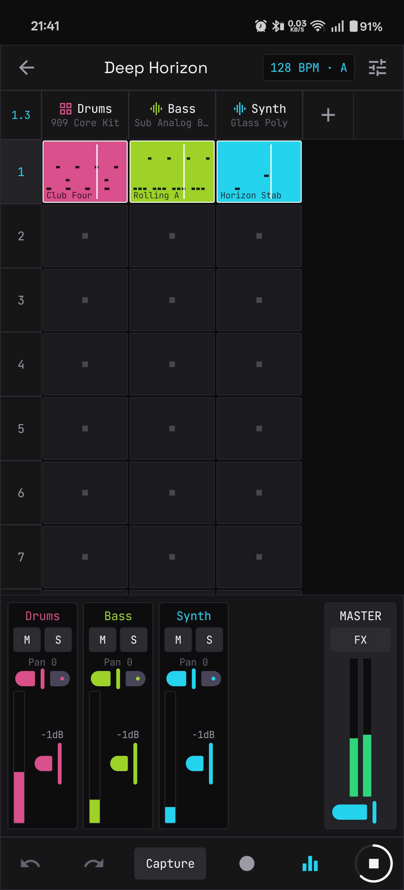
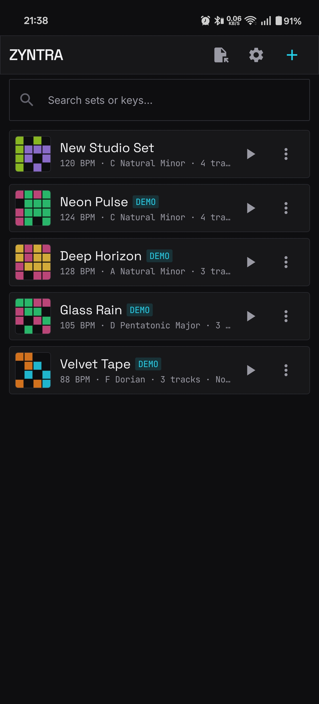
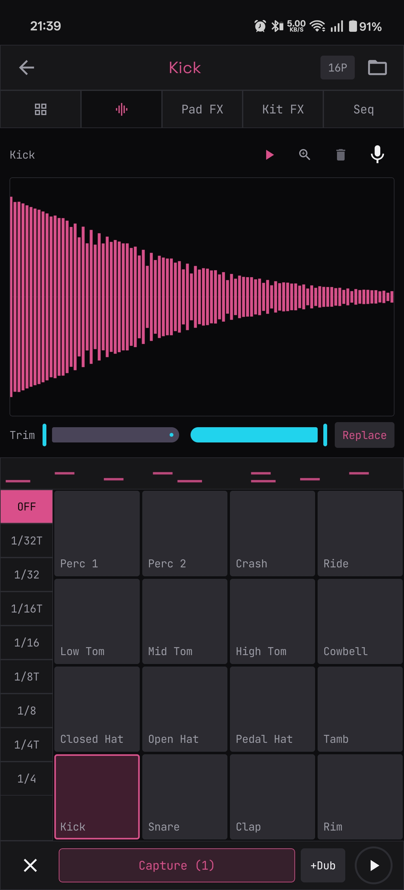
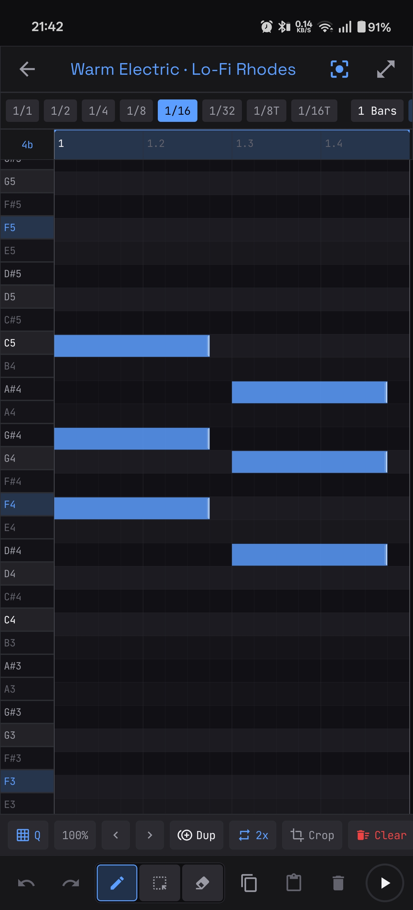
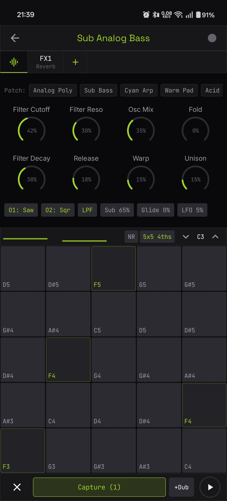
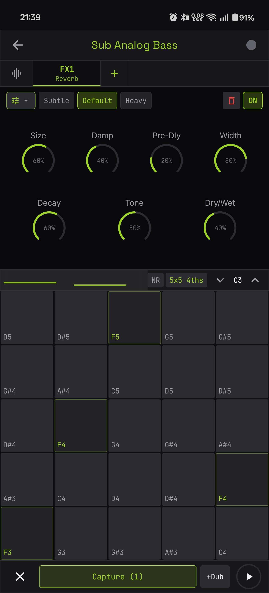
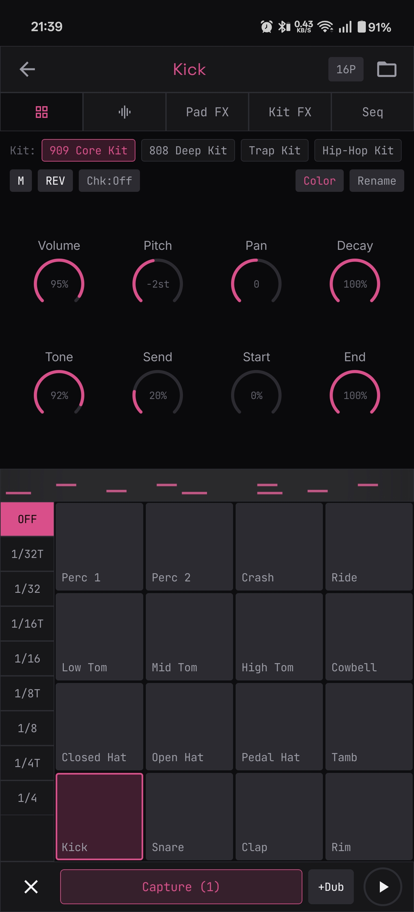
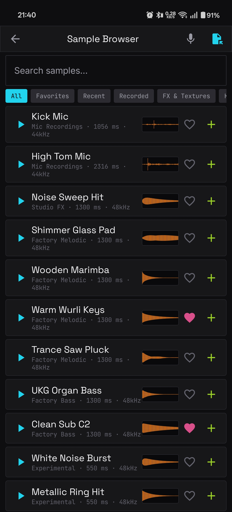

# 🎹 ZYNTRA

<p align="center">
  <strong>A pocket-sized music studio. Your ideas, your sound, your workflow.</strong>
  <br />
  A mobile-first, offline-first digital audio workstation for Android.
</p>

<p align="center">
  
  
  
  
  
</p>

---

## ⬇️ Download

The latest Android APK will be published on the [**GitHub Releases**](https://github.com/Barath702/Zyntra/releases/latest) page.

- Download the `ZYNTRA.apk` asset from the latest release.
- Open the APK on your Android device.
- If prompted, allow installation from your browser or file manager.
- Install ZYNTRA and start making music!

> **Note:** APK availability depends on a published release. Check the Releases page for the current version.

## 🌌 About ZYNTRA

ZYNTRA is an Android digital audio workstation built for making music on the move. It brings together a Jetpack Compose studio interface and a native **C++17 audio engine powered by Oboe**, with tools for sequencing, sound design, MIDI performance and exporting your work.

The goal is simple: give your musical ideas room to grow, without making you depend on a cloud account or an always-online workflow.

> 🚧 **Development status:** ZYNTRA is actively being developed. The feature list reflects the current project source, but a stable release and compatibility across devices have not yet been independently verified.

## ✨ Features

### 🎛️ Make music
- **Session-based workflow** - Work with scenes and clips, launch clips and keep your musical ideas moving.
- **MIDI capture and overdub** - Record and layer MIDI performances.
- **Drum sequencing** - Program beats with a pad-based drum workflow and sample playback.
- **Piano roll editor** - Draw, select, erase, resize and quantize notes, with velocity and automation workflows.

### 🎹 Shape your sound
- **Native audio engine** - C++17 audio processing built on Google's Oboe audio library.
- **Instruments** - Synthesizer and sampler workflows.
- **Effects rack** - EQ, dynamics, delay and other time-based effects, modulation, saturation, distortion, bitcrushing, filtering and stereo processing.
- **MIDI hardware support** - USB and BLE MIDI integration where supported by the Android device and connected hardware.

### 📤 Take your work with you
- **WAV export** - Render audio to WAV.
- **MIDI export** - Export Standard MIDI Files.
- **Project data** - Save and export projects using the app's JSON project format.
- **Offline-first approach** - Core music-making workflows are designed to run locally, without requiring an account or cloud service.

## 📸 App screenshots

Explore the ZYNTRA studio interface and music-making workflow.

<p align="center">
  
  
  
  
</p>
<p align="center">
  
  
  
  
</p>

## 🧱 Technology

| Component | Technology |
|---|---|
| Platform | Android |
| User interface | Kotlin, Jetpack Compose |
| Audio engine | C++17, Oboe |
| Native build | Android NDK, CMake |
| Build system | Gradle |
| Minimum Android version | Android 10 (SDK 29) |
| Compile / target SDK | 36 |

## 🚀 Build from source

Want to explore the code or build ZYNTRA yourself? Here's what you'll need.

### Prerequisites

- Android Studio with a compatible Android SDK
- JDK 17 or newer
- Gradle **9.3.1**
- Android SDK Platform 36
- Android NDK **28.2.13676358**
- CMake **4.1.2**

Install the required SDK, NDK and CMake versions through Android Studio's SDK Manager.

### Build with Gradle

The repository currently contains the Gradle wrapper configuration, but not the wrapper launchers (`gradlew`, `gradlew.bat`) or `gradle-wrapper.jar`. Until those files are added, install Gradle 9.3.1 separately and run the following commands from the project root:

```bash
# Build a debug APK
gradle :app:assembleDebug

# Run unit tests
gradle :app:testDebugUnitTest

# Build a release APK (requires a release keystore)
KEYSTORE_PATH=/absolute/path/to/upload-key.jks \
STORE_PASSWORD='your-store-password' \
KEY_PASSWORD='your-key-password' \
gradle :app:assembleRelease
```

The debug APK is normally generated at:

```
app/build/outputs/apk/debug/
```

### 🔐 Release signing

Release signing uses the following environment variables:

- `KEYSTORE_PATH`
- `STORE_PASSWORD`
- `KEY_PASSWORD`

The configured key alias is `upload`. Keep your keystore and credentials private. **Never commit signing keys, passwords, API keys or local environment files.**

## 🗂️ Project compatibility

ZYNTRA stores projects locally and supports project serialization and export. The current codebase retains the historical `.notecraft.json` extension for compatibility with existing project data. This legacy extension and internal class names do not change the displayed app name: **ZYNTRA**.

## 🤝 Contributing

Ideas, bug reports and focused pull requests are welcome!

When reporting an issue, please include:

- Android version and device model
- Steps to reproduce the issue
- Expected behaviour and actual behaviour
- Relevant logs, with personal information and secrets removed

Please don't attach private project files, copyrighted sample packs, signing keys or credentials to issues.

## 📜 License

The original source code in this repository is licensed under the [MIT License](LICENSE).

The MIT license applies only to material for which the project contributors hold the necessary rights. Third-party libraries, fonts, audio samples, presets, demo projects, artwork and other bundled assets may have separate licenses or usage terms. Their inclusion here does not relicense them. Verify and document the applicable license and attribution for each such item before redistributing the project or publishing builds.

## 🙌 Acknowledgements

ZYNTRA is built with open-source libraries and Android platform technologies. See `gradle/libs.versions.toml` and the relevant upstream projects for their individual licenses.

---

<p align="center">
  <strong>🎶 Make something worth listening to.</strong>
  <br />
  <sub>Built with curiosity, code and a love for music.</sub>
</p>
